<picture><source media="(prefers-color-scheme: dark)" srcset="assets/hero-dark.svg"></picture>

<picture><source media="(prefers-color-scheme: dark)" srcset="assets/about-dark.svg"></picture>

<picture><source media="(prefers-color-scheme: dark)" srcset="assets/stack-dark.svg"></picture>

<a href="https://github.com/ItzMrazotyaLin/Moderatio"><picture><source media="(prefers-color-scheme: dark)" srcset="assets/project-moderatio-dark.svg"></picture></a>&nbsp;<a href="https://github.com/ItzMrazotyaLin/Restartify"><picture><source media="(prefers-color-scheme: dark)" srcset="assets/project-restartify-dark.svg"></picture></a>

<a href="https://github.com/ItzMrazotyaLin/clearifyos-installer"><picture><source media="(prefers-color-scheme: dark)" srcset="assets/project-clearifyos-installer-dark.svg"></picture></a>&nbsp;<a href="https://github.com/ItzMrazotyaLin/AndroWallp"><picture><source media="(prefers-color-scheme: dark)" srcset="assets/project-androwallp-dark.svg"></picture></a>

<picture><source media="(prefers-color-scheme: dark)" srcset="assets/stats-dark.svg"></picture>

<picture><source media="(prefers-color-scheme: dark)" srcset="assets/wave-dark.svg"></picture>

<a href="https://itzmrazotyalin.github.io"><picture><source media="(prefers-color-scheme: dark)" srcset="assets/button-1-dark.svg"></picture></a>&nbsp;&nbsp;<a href="https://github.com/ItzMrazotyaLin?tab=repositories"><picture><source media="(prefers-color-scheme: dark)" srcset="assets/button-2-dark.svg"></picture></a>

<a href="https://metawka.github.io/expressive-profile/?from=ItzMrazotyaLin"><picture><source media="(prefers-color-scheme: dark)" srcset="assets/credit-dark.svg"></picture></a>

